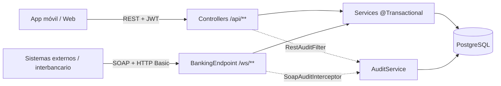
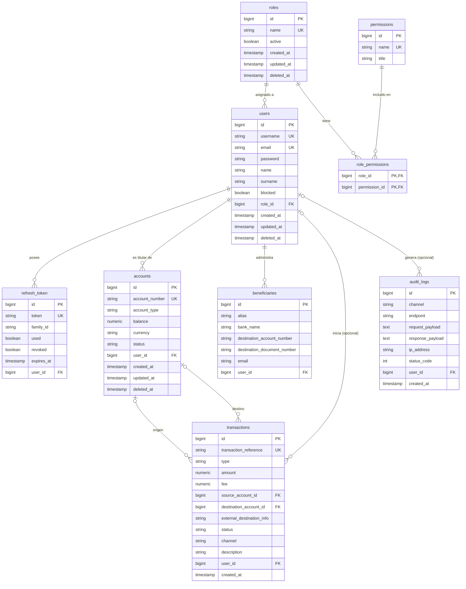

# Documentación Técnica — Backend `spring-app`

## 1. Resumen general

Backend de **banca digital híbrida** construido con **Spring Boot 3.5.8 + Java 21**. Expone dos canales sobre la misma lógica de negocio:

- **REST (JSON)** para apps móviles y portales web, autenticado con JWT y autorización por permisos.
- **SOAP (XML, contrato `.xsd` / WSDL)** para integraciones corporativas e interbancarias, autenticado como cliente máquina-a-máquina.

Gestiona **usuarios, roles y permisos** (RBAC) y el dominio financiero: **cuentas, beneficiarios, transacciones y auditoría**. Persiste en PostgreSQL vía JPA/Hibernate.

**Paquete raíz:** `com.server.app` · **Clase principal:** `AppApplication`

### Stack técnico
- Java 21
- Spring Boot 3.5.8 (Web, Security, Data JPA, Validation y Actuator)
- Spring Web Services (SOAP), `wsdl4j` y runtime JAXB (`jakarta`)
- PostgreSQL con Hibernate (H2 solo para tests)
- JJWT 0.12.6 para JWT HMAC
- BCrypt para contraseñas
- MapStruct 1.6.3 y Lombok
- Springdoc OpenAPI 2.8.5
- `spring-dotenv` para cargar `.env`
- Maven Wrapper y Docker con Eclipse Temurin 21


## 2. Arquitectura por capas

```
controller/   → Endpoints REST
soap/         → Canal SOAP (endpoint, modelos JAXB, configuración WS, interceptores)
service/      → Lógica de negocio (compartida por REST y SOAP)
repository/   → Acceso a datos (Spring Data JPA)
domain/
  model/      → Entidades JPA (y enums en model/enums)
  dto/        → DTOs de entrada/salida por módulo (auth, user, role, permission, account,
                beneficiary, transaction, audit, base)
  mapper/     → Interfaces MapStruct (Entity ↔ DTO)
config/       → Seguridad (REST y SOAP), CORS, JWT, OpenAPI, paginación, Jackson
filter/       → Filtros de autenticación (JWT) y de auditoría REST
seeders/      → Poblado automático al arrancar (roles, permisos, super admin)
common/
  constants/  → Nombres de roles y permisos
  security/   → Utilidades de autorización
  exceptions/ → Excepciones de negocio + manejador global
  pagination/ → Wrapper estándar de respuestas paginadas
resources/
  xsd/        → Contrato SOAP (banking.xsd)
```

Los módulos `User` y `Role` implementan una interfaz genérica `IBaseService<ID, CreateDto, UpdateDto, ResponseDto>` con los métodos CRUD estándar (`create`, `update`, `findById`, `delete`, `restore`).

### Flujo común de los dos canales



Los controladores REST y el endpoint SOAP son **adaptadores delgados**: solo traducen JSON/XML a DTOs y delegan en los mismos servicios. Ninguna regla de negocio vive en el canal.


## 3. Modelo de datos

### 3.1 Diagrama entidad-relación (ERD)



Notas del diagrama:
- `users.role_id`: un usuario tiene un solo rol; un rol tiene muchos permisos (N:M vía `role_permissions`).
- `transactions.source_account_id` es nulo en un **depósito** y `destination_account_id` es nulo en un **retiro**.
- `transactions.user_id` y `audit_logs.user_id` son opcionales: las llamadas SOAP de sistemas externos no tienen usuario humano.
- `balance`, `amount` y `fee` son `numeric(19,2)` (`BigDecimal` en Java), nunca `double`/`float`.

### 3.2 Entidades

#### `BaseEntity` (`@MappedSuperclass`)
Heredado por `User`, `Role` y `Account`: `createdAt`, `updatedAt` (auto-actualizado en `@PreUpdate`), `deletedAt` (soft delete).

#### `User`
`id`, `username` (único), `email` (único), `name`, `surname`, `password` (hash BCrypt), `blocked` (default `false`), `role` (`@ManyToOne` LAZY).

#### `Role`
`id`, `name` (único), `active` (default `true`), `permissions` (`@ManyToMany` LAZY vía tabla `role_permissions`).

#### `Permission`
`id`, `name` (único) y `title` descriptivo editable. Los nombres de permisos se definen en `PermissionNames`.

#### `RefreshToken`
`token` (hash SHA-256 del valor real), `familyId` (agrupa tokens rotados de una misma sesión), `used`, `revoked`, `user` (`@ManyToOne` EAGER), `expiresAt`.

#### `Account`
`id`, `accountNumber` (12 dígitos, único, no modificable), `accountType` (`SAVINGS`, `CHECKING`), `balance`, `currency` (ISO de 3 letras, por defecto `USD`), `status` (`ACTIVE`, `FROZEN`, `CLOSED`), `user` (titular). Tiene una restricción de base de datos `balance >= 0` como última línea de defensa.

#### `Beneficiary`
`alias`, `bankName`, `destinationAccountNumber`, `destinationDocumentNumber`, `email`, `user`. Restricción única por `(user_id, bank_name, destination_account_number)`.

#### `Transaction`
Registro **inmutable** de movimientos: no se actualiza ni se borra; las correcciones se hacen con una transacción nueva.
- `transactionReference` (único), `type` (`DEPOSIT`, `WITHDRAWAL`, `TRANSFER`, `PAYMENT`), `amount`, `fee`.
- `sourceAccount`, `destinationAccount`, `externalDestinationInfo` (reservado para interbancario).
- `status` (`PENDING`, `COMPLETED`, `FAILED`, `REVERSED`), `channel` (`REST`, `SOAP`), `description`, `user` (opcional), `createdAt`.

#### `AuditLog`
`channel`, `endpoint`, `requestPayload`, `responsePayload`, `ipAddress`, `statusCode`, `user` (opcional), `createdAt`.


## 4. Seguridad y autenticación

El proyecto tiene **dos cadenas de seguridad independientes**:

| Cadena | Orden | Alcance | Mecanismo |
|---|---|---|---|
| `SoapSecurityConfig` | `@Order(1)` | `/ws/**` | HTTP Basic, cliente máquina-a-máquina (authority `SOAP_CLIENT`) |
| `SecurityConfig` | `@Order(2)` | Resto (`/api/**`, etc.) | JWT stateless + `@PreAuthorize` |

Con el servlet SOAP registrado hay más de un servlet en la aplicación, por lo que los patrones de ruta se declaran con `PathPatternRequestMatcher` (los patrones `String` son ambiguos para Spring Security en ese caso).

### 4.1 Flujo de request (REST)
```
Request → CORS → SecurityFilterChain → JwtAuthenticationFilter → Controller → RestAuditFilter
```
`SecurityConfig` desactiva CSRF, fuerza sesiones stateless, permite las operaciones públicas de autenticación y exige autenticación para el resto. El control de permisos se aplica con `@PreAuthorize` y las authorities cargadas por `JwtAuthenticationFilter`.

### 4.2 Rutas públicas y autenticadas
- Públicas en `SecurityConfig`: `POST /api/auth/login`, `POST /api/auth/signup`, `POST /api/auth/refresh` y `POST /api/auth/logout`.
- Autenticadas: perfil, cambio de contraseña y todos los endpoints de usuarios, roles, permisos y del dominio bancario.
- OpenAPI: `/v3/api-docs` y `/swagger-ui.html`.
- SOAP: `GET /ws/*.wsdl` es público; cualquier otra llamada a `/ws/**` exige HTTP Basic.

### 4.3 `JwtAuthenticationFilter`
- Lee el header `Authorization: Bearer <token>`. **Si el header no existe, el filtro deja pasar la petición** sin autenticarla; es la capa de autorización (`anyRequest().authenticated()`) la que rechaza las rutas protegidas. Por eso las rutas públicas de `/api/auth/**` funcionan sin token.
- Si el header existe: verifica firma y expiración, y extrae el id desde el claim `id`.
- Carga el perfil actual desde la base de datos en cada request.
- Rechaza (401) usuarios bloqueados o con roles inactivos.
- Registra como authorities los nombres de los permisos y `ROLE_<NOMBRE_ROL>`.
- El principal almacenado en el contexto es un `ProfileResponseDto`; los controladores lo reciben con `@AuthenticationPrincipal`.

### 4.4 Autorización por permisos
Los controladores usan `@PreAuthorize("hasAuthority('PERMISO')")`. Las authorities se obtienen desde `role_permissions` y se agregan al contexto de Spring Security por cada request.

El usuario con role `SUPER_ADMIN` recibe todos los permisos disponibles durante el `RoleSeeder`. Además, sus operaciones de edición de role están protegidas en `RoleServiceImpl` y el usuario super administrador no puede modificarse, eliminarse ni restaurarse desde la API.

### 4.5 `JsonWebTokenProvider`
Firma HMAC con clave Base64. El JWT solo contiene el `id` del usuario; rol, permisos y estado se resuelven en cada request desde BD. `expiration-time` configurable en milisegundos.

### 4.6 Refresh tokens (`RefreshTokenService`)
Rotación con detección de reuso:
1. Al login/signup se emite un refresh token (UUID); se guarda su **hash SHA-256** junto a un `familyId`.
2. En `/refresh`, si el token ya fue usado o está revocado → se revoca **toda la familia** y se lanza `UnauthorizedException`.
3. Si es válido, se marca `used=true` y se emite uno nuevo con el mismo `familyId`.
4. `/logout` revoca la familia completa.
5. TTL de **7 días**.

### 4.7 `PermissionSeeder` (`@Order(0)`)
Al arrancar (`ApplicationReadyEvent`), crea en BD los permisos definidos en `PermissionNames.HIERARCHY` que todavía no existan. No elimina permisos existentes.

### 4.8 `RoleSeeder` (`@Order(1)`)
Crea, si no existen, los roles base `SUPER_ADMIN`, `ADMIN` y `CLIENT` (constantes en `RoleNames`). Después:
- Asigna a `SUPER_ADMIN` todos los registros de la tabla `permissions`, por lo que también actualiza instalaciones existentes cuando se agregan nuevos permisos.
- **Agrega** al rol `CLIENT` los permisos de `PermissionNames.CLIENT_PERMISSIONS` (operar sobre lo propio). Es aditivo: nunca quita permisos, para no pisar cambios hechos desde la API de roles.

`ADMIN` no recibe permisos automáticamente; se le asignan desde la API de roles o por SQL (ver sección 13).

### 4.9 `SuperAdminSeeder` (`@Order(2)`)
Crea automáticamente el usuario `SUPER_ADMIN` al arrancar, garantizando que solo exista uno:
- Verifica `userRepository.existsByRole_Name(RoleNames.SUPER_ADMIN)`; si ya existe, no hace nada.
- Si el rol `SUPER_ADMIN` aún no existe, lanza `IllegalStateException`.
- Usa `SUPER_ADMIN_USERNAME`, `SUPER_ADMIN_EMAIL` y `SUPER_ADMIN_PASSWORD`.
- Guarda la contraseña mediante `BCryptPasswordEncoder`.

### 4.10 Protección del usuario `SUPER_ADMIN` (`UserServiceImpl`)
`update`, `delete` y `restore` verifican si el usuario objetivo tiene rol `SUPER_ADMIN`; si es así, lanzan `ConfictException` y bloquean la operación. El único `SUPER_ADMIN` del sistema queda protegido de ser modificado o eliminado vía API.

### 4.11 Catálogo de permisos

| Permiso | Operaciones protegidas | `CLIENT` |
|---|---|:---:|
| `USER_CREATE` | Crear usuarios | |
| `USER_READ` | Listar y consultar usuarios | |
| `USER_UPDATE` | Actualizar usuarios | |
| `USER_DELETE` | Eliminar y restaurar usuarios | |
| `ROLE_CREATE` | Crear roles | |
| `ROLE_READ` | Listar y consultar roles | |
| `ROLE_UPDATE` | Actualizar roles | |
| `ROLE_DELETE` | Eliminar y restaurar roles | |
| `PERMISSION_READ` | Listar permisos | |
| `PERMISSION_UPDATE` | Actualizar el título de un permiso | |
| `ACCOUNT_CREATE` | Abrir cuentas | |
| `ACCOUNT_READ` | Ver las cuentas propias | ✔ |
| `ACCOUNT_READ_ALL` | Ver cualquier cuenta; abrir cuentas a nombre de otro usuario (personal del banco) | |
| `ACCOUNT_UPDATE` | Congelar, reactivar o cerrar cuentas | |
| `TRANSFER_CREATE` | Transferir desde cuentas propias | ✔ |
| `TRANSACTION_CREATE` | Depósitos y retiros de ventanilla | |
| `TRANSACTION_READ` | Ver los movimientos propios | ✔ |
| `TRANSACTION_READ_ALL` | Ver cualquier movimiento | |
| `BENEFICIARY_CREATE` | Crear beneficiarios propios | ✔ |
| `BENEFICIARY_READ` | Listar beneficiarios propios | ✔ |
| `BENEFICIARY_DELETE` | Eliminar beneficiarios propios | ✔ |
| `AUDIT_READ` | Consultar la auditoría | |

El seeder asigna los 22 permisos a `SUPER_ADMIN` y los marcados con ✔ a `CLIENT`. Los endpoints de autenticación y perfil tienen reglas propias y no usan estos permisos.


## 5. Endpoints REST

### `/api/auth` (`AuthController`)
| Método | Ruta | Acceso | Descripción |
|---|---|---|---|
| POST | `/login` | público | Retorna `AuthResponseDto` (JWT + refresh + perfil) |
| POST | `/signup` | público | Crea usuario con rol `CLIENT` por defecto, 201 + tokens |
| POST | `/refresh` | público | Rota el refresh token |
| POST | `/logout` | público | Revoca la familia del refresh token |
| GET | `/profile` | autenticado | Perfil del usuario actual |
| PUT | `/profile` | autenticado | Actualiza username/name/surname/email |
| PATCH | `/password` | autenticado | Cambia contraseña |

### `/api/users` (`UserController`) — requiere permiso explícito
`GET /` (paginado, filtros `search`, `role`, `deleted`), `GET /{id}`, `POST /`, `PUT /{id}`, `DELETE /{id}` (soft delete), `PATCH /{id}/restore`.

### `/api/roles` (`RoleController`)
`GET /` (paginado, filtros `search` y `deleted`), `GET /{id}`, `POST /`, `PUT /{id}`, `DELETE /{id}` (soft delete), `PATCH /{id}/restore`.

### `/api/permissions` (`PermissionController`)
`GET /` (paginado), `PUT /{id}` (solo editable el `title`).

### `/api/accounts` (`AccountController`)
| Método | Ruta | Permiso | Descripción |
|---|---|---|---|
| POST | `/` | `ACCOUNT_CREATE` | Abre una cuenta (saldo inicial 0). `userId` opcional: solo con `ACCOUNT_READ_ALL` se puede abrir a nombre de otro usuario |
| GET | `/me` | `ACCOUNT_READ` | Cuentas del usuario autenticado (paginado) |
| GET | `/` | `ACCOUNT_READ_ALL` | Todas las cuentas (paginado) |
| GET | `/{id}` | `ACCOUNT_READ` | Detalle; un cliente solo ve las suyas (404 si no es suya) |
| PATCH | `/{id}/status` | `ACCOUNT_UPDATE` | Cambia el estado. No se puede cerrar con saldo distinto de cero |

### `/api/beneficiaries` (`BeneficiaryController`)
`GET /` (`BENEFICIARY_READ`), `POST /` (`BENEFICIARY_CREATE`), `DELETE /{id}` (`BENEFICIARY_DELETE`). Siempre operan sobre los beneficiarios del usuario autenticado.

### `/api/transactions` (`TransactionController`)
| Método | Ruta | Permiso | Descripción |
|---|---|---|---|
| POST | `/transfer` | `TRANSFER_CREATE` | Transferencia entre cuentas internas. La cuenta origen debe ser del usuario |
| POST | `/deposit` | `TRANSACTION_CREATE` | Depósito de ventanilla |
| POST | `/withdraw` | `TRANSACTION_CREATE` | Retiro de ventanilla |
| GET | `/me` | `TRANSACTION_READ` | Movimientos donde participa una cuenta del usuario (paginado, más recientes primero) |
| GET | `/` | `TRANSACTION_READ_ALL` | Todos los movimientos (paginado) |
| GET | `/{id}` | `TRANSACTION_READ` | Detalle; solo si el usuario participa (o tiene `TRANSACTION_READ_ALL`) |

Ejemplo de transferencia:
```json
POST /api/transactions/transfer
{
  "sourceAccountNumber": "482910573621",
  "destinationAccountNumber": "770312948856",
  "amount": 25.50,
  "description": "Pago de alquiler",
  "reference": "TRF-2026-000123"
}
```
`reference` es opcional y funciona como **clave de idempotencia**: reenviar la misma operación con la misma referencia devuelve el movimiento original en lugar de duplicarlo. Si la referencia ya se usó con otros datos, responde `409`.

### `/api/audit-logs` (`AuditLogController`)
`GET /` (`AUDIT_READ`, paginado, más recientes primero).

Todas las respuestas paginadas usan `PaginationResponse<T>` (`data` + metadata: `page` 1-indexado, `pageSize`, `pageCount`, `total`).


## 6. Canal SOAP

### 6.1 Contrato
- Esquema: `src/main/resources/xsd/banking.xsd`, namespace `http://server.com/banking/ws`.
- WSDL generado automáticamente: `GET /ws/banking.wsdl`.
- Endpoint: `POST /ws` (servlet `MessageDispatcherServlet` mapeado a `/ws/*`).
- Las peticiones se **validan contra el XSD** antes de llegar a la lógica de negocio (cuenta de 12 dígitos, monto positivo con 2 decimales, longitudes máximas).

### 6.2 Operaciones
| Operación | Request / Response | Descripción |
|---|---|---|
| `GetBalance` | `GetBalanceRequest` / `GetBalanceResponse` | Consulta saldo, moneda y estado de una cuenta |
| `Transfer` | `TransferRequest` / `TransferResponse` | Transferencia entre cuentas internas (liquidación / lotes) |

Ejemplo:
```xml
<soapenv:Envelope xmlns:soapenv="http://schemas.xmlsoap.org/soap/envelope/"
                  xmlns:ws="http://server.com/banking/ws">
  <soapenv:Header/>
  <soapenv:Body>
    <ws:TransferRequest>
      <ws:sourceAccountNumber>482910573621</ws:sourceAccountNumber>
      <ws:destinationAccountNumber>770312948856</ws:destinationAccountNumber>
      <ws:amount>100.00</ws:amount>
      <ws:description>Liquidación lote 45</ws:description>
      <ws:reference>LOTE45-0001</ws:reference>
    </ws:TransferRequest>
  </soapenv:Body>
</soapenv:Envelope>
```

### 6.3 Autenticación
HTTP Basic con las credenciales `SOAP_CLIENT_USERNAME` / `SOAP_CLIENT_PASSWORD`, **solo sobre TLS**. Al ser un cliente máquina-a-máquina, las transferencias SOAP no tienen usuario humano (`user_id` nulo) ni verificación de propiedad de la cuenta origen: el cliente SOAP es un sistema de confianza. Para WS-Security con certificados (WSS4J), `SoapSecurityConfig` es el punto a reemplazar.

### 6.4 Errores
Las excepciones de negocio se convierten en **SOAP Fault**: `NotFoundException`, `BadRequestException`, `ConfictException` y `ForbiddenException` → `Client`; `ServerException` y cualquier otra → `Server`. El texto del fault es el mensaje de la excepción.

### 6.5 Componentes
- `BankingEndpoint`: `@Endpoint` que traduce XML ⇄ DTO y delega en `AccountService` y `TransactionService`.
- `soap/model/*`: clases JAXB escritas a mano que reflejan el XSD (si se cambia el XSD hay que actualizarlas).
- `WebServiceConfig`: servlet, publicación del WSDL, validación contra XSD y resolver de faults.
- `SoapAuditInterceptor`: registra en `audit_logs` el XML de entrada y salida.


## 7. Reglas del dominio bancario

### 7.1 Movimientos de dinero (`TransactionService`)
Es la **única** capa que modifica saldos. Todo ocurre dentro de una transacción de base de datos (`@Transactional`): si algo falla, no se aplica nada.

Validaciones de una transferencia:
1. Monto mayor que cero y con máximo 2 decimales.
2. Cuentas origen y destino distintas y existentes.
3. Cuentas en estado `ACTIVE` (no `FROZEN` ni `CLOSED`).
4. Misma moneda en ambas cuentas (no hay conversión automática).
5. Fondos suficientes (`monto + comisión`; la comisión es hoy `0` y es un punto de extensión).
6. En REST, la cuenta origen debe pertenecer al usuario autenticado; si no, responde `404` para no revelar que la cuenta existe.

### 7.2 Concurrencia
- Se resuelven primero solo los **ids** de las cuentas y luego se toman **bloqueos pesimistas** (`SELECT ... FOR UPDATE`) **ordenados por id**. Así dos transferencias cruzadas (A→B y B→A) no se bloquean entre sí (sin deadlock) y el saldo siempre se lee ya con el bloqueo tomado (sin *lost update*).
- La restricción `balance >= 0` en base de datos es la última barrera.

### 7.3 Idempotencia
La `reference` opcional (REST y SOAP) evita duplicar movimientos ante reintentos. Si no se envía, el sistema genera una referencia `TX-XXXXXXXXXXXXXXXXXXXX`.

### 7.4 Cuentas
- El número de cuenta son 12 dígitos aleatorios (`SecureRandom`) verificados como únicos.
- Todas las cuentas se abren con saldo 0; el dinero entra solo mediante depósitos o transferencias.
- No se puede abrir una cuenta a un usuario bloqueado o eliminado.
- Cerrar una cuenta exige saldo exactamente 0; una cuenta cerrada no puede cambiar de estado.

### 7.5 Auditoría
- **REST:** `RestAuditFilter` registra las operaciones que modifican estado (`POST`, `PUT`, `PATCH`, `DELETE`) sobre `/api/**`, con usuario, IP, payloads y código HTTP. Se omiten `GET` y `/api/auth/**`.
- **SOAP:** `SoapAuditInterceptor` registra cada llamada, incluidas las peticiones inválidas y los faults.
- Se enmascaran los campos `password`, `currentPassword`, `newPassword`, `confirmNewPassword`, `token`, `refreshToken` y `accessToken`, y cada payload se trunca a 10 000 caracteres.
- El registro se guarda en una transacción independiente (`REQUIRES_NEW`): queda constancia aunque la operación de negocio haga rollback. Un fallo de auditoría se registra en el log y **nunca** rompe la respuesta al cliente.
- Las peticiones rechazadas por Spring Security (por ejemplo 401/403) no llegan al filtro de auditoría REST.


## 8. Manejo de errores (`AdviceController`)

`@RestControllerAdvice` global que traduce excepciones a `ExceptionResponse { status, message }`:

| Excepción | HTTP |
|---|---|
| `BadCredentialsException` / `UnauthorizedException` | 401 |
| `AccessDeniedException` / `ForbiddenException` | 403 |
| `NotFoundException` | 404 |
| `ConfictException` | 409 |
| `BadRequestException` | 400 |
| `ServerException` | 500 |
| `MethodArgumentNotValidException` / `MissingServletRequestParameterException` / `MethodArgumentTypeMismatchException` | 400 |
| `RuntimeException` genérica | 400 |
| `Exception` genérica | 500 |

Casos típicos del dominio bancario: fondos insuficientes, cuenta no activa y referencia duplicada → `409`; monto inválido o monedas distintas → `400`; cuenta ajena o inexistente → `404`.


## 9. Configuración (`application.properties`)

Todo alimentado por variables de entorno:
```
server.port=${SERVER_PORT}
spring.application.name=${SPRING_APPLICATION_NAME}

spring.datasource.url=${SPRING_DATASOURCE_URL}
spring.datasource.username=${SPRING_DATASOURCE_USERNAME}
spring.datasource.password=${SPRING_DATASOURCE_PASSWORD}
spring.datasource.driver-class-name=${SPRING_DATASOURCE_DRIVER_CLASS_NAME}

spring.jpa.properties.hibernate.dialect=${SPRING_JPA_PROPERTIES_HIBERNATE_DIALECT}
spring.jpa.hibernate.ddl-auto=${SPRING_JPA_HIBERNATE_DDL_AUTO}
spring.jpa.show-sql=${SPRING_JPA_SHOW_SQL}
spring.jpa.open-in-view=false

spring.cors.allowed.origins=${CORS_ALLOWED_ORIGINS}

security.jwt.secret-key=${SECURITY_JWT_SECRET_KEY}
security.jwt.expiration-time=${SECURITY_JWT_EXPIRATION_TIME}

springdoc.api-docs.path=/v3/api-docs
springdoc.swagger-ui.path=/swagger-ui.html
springdoc.swagger-ui.operationsSorter=method
spring.jackson.serialization.write-dates-as-timestamps=false

management.endpoints.web.exposure.include=health
management.endpoint.health.show-details=never

security.super-admin.username=${SUPER_ADMIN_USERNAME}
security.super-admin.email=${SUPER_ADMIN_EMAIL}
security.super-admin.password=${SUPER_ADMIN_PASSWORD}

# Canal SOAP: credenciales del cliente máquina-a-máquina (HTTP Basic sobre TLS)
security.soap.username=${SOAP_CLIENT_USERNAME}
security.soap.password=${SOAP_CLIENT_PASSWORD}
```
`spring.jpa.open-in-view=false`, Swagger en `/v3/api-docs` y `/swagger-ui.html`, solo se expone el endpoint `health` de Actuator sin detalles.

### Variables de entorno (`.env`)

| Variable | Descripción |
|---|---|
| `SERVER_PORT` | Puerto del servidor |
| `SPRING_APPLICATION_NAME` | Nombre de la aplicación |
| `SPRING_DATASOURCE_URL` / `_USERNAME` / `_PASSWORD` / `_DRIVER_CLASS_NAME` | Conexión a PostgreSQL |
| `SPRING_JPA_PROPERTIES_HIBERNATE_DIALECT` | Dialecto de Hibernate |
| `SPRING_JPA_HIBERNATE_DDL_AUTO` | Estrategia de esquema (en producción, preferir migraciones) |
| `SPRING_JPA_SHOW_SQL` | Mostrar SQL en logs |
| `CORS_ALLOWED_ORIGINS` | Orígenes permitidos |
| `SECURITY_JWT_SECRET_KEY` | Clave HMAC en Base64 |
| `SECURITY_JWT_EXPIRATION_TIME` | Expiración del JWT en milisegundos |
| `SUPER_ADMIN_USERNAME` / `_EMAIL` / `_PASSWORD` | Datos del super administrador inicial |
| **`SOAP_CLIENT_USERNAME`** |  Usuario del cliente SOAP |
| **`SOAP_CLIENT_PASSWORD`** |  Contraseña del cliente SOAP |

No se deben versionar valores reales; el `.env` debe estar en `.gitignore`.


## 10. Paginación y búsqueda
- `PageableConfig` fuerza que `page` sea 1-indexado.
- `UserSpecifications` filtra por texto, `roleId` y `deleted`.
- `RoleSpecifications` filtra por texto y `deleted`.
- Los listados bancarios usan `@PageableDefault` ordenado por `createdAt` descendente.
- Los repositorios usan `EntityGraph` para cargar roles, permisos, titulares y cuentas cuando es necesario y evitar N+1. El listado de movimientos propios usa `LEFT JOIN` explícito porque un depósito no tiene cuenta origen y un retiro no tiene cuenta destino.
- Las respuestas paginadas usan `PaginationResponse<T>` con `data`, `page`, `pageSize`, `pageCount` y `total`.

## 11. Mapeo de datos (MapStruct)
- Los mappers ignoran ids, contraseñas, relaciones gestionadas por el servicio y fechas de auditoría cuando corresponde.
- Las actualizaciones usan `NullValuePropertyMappingStrategy.IGNORE`, por lo que los campos `null` no sobrescriben valores existentes.
- `RoleMapper.toSummaryDto` omite permisos en listados para reducir el payload.
- `AccountMapper` y `TransactionMapper` aplanan las relaciones (`userId`, `sourceAccountNumber`, `destinationAccountNumber`) para no exponer entidades completas.

## 12. DTOs principales

### Autenticación
- `LoginDto`: `username` y `password`, ambos obligatorios.
- `SignUpDto`: `username`, `name`, `surname`, `email` y `password`; la contraseña requiere mínimo 8 caracteres.
- `UpdateProfileDto`: username, nombre, apellido y email obligatorios.
- `UpdatePasswordDto`: contraseña actual, nueva contraseña y confirmación; la nueva requiere mínimo 8 caracteres.
- `AuthResponseDto`: JWT, refresh token y perfil.

### Usuarios, roles y permisos
- `UserCreateDto`: username, name, surname, email, password y role opcional mediante `IdDto`.
- `UserUpdateDto`: username, name, surname, blocked, email y role opcional.
- `RoleCreateDto` y `RoleUpdateDto`: `name`, `active` y permisos opcionales mediante ids.
- `PermissionUpdateDto`: `title` obligatorio, entre 3 y 100 caracteres.
- Las respuestas incluyen datos de auditoría (`createdAt`, `updatedAt` y `deletedAt`) cuando corresponde.

### Dominio bancario
- `AccountCreateDto`: `accountType` obligatorio, `currency` opcional (3 letras mayúsculas) y `userId` opcional.
- `AccountStatusDto`: `status` obligatorio.
- `AccountResponseDto`: id, número, tipo, saldo, moneda, estado, `userId` y fechas.
- `BeneficiaryCreateDto`: `alias`, `bankName` y `destinationAccountNumber` obligatorios; `destinationDocumentNumber` y `email` opcionales.
- `TransferRequestDto`: cuentas origen/destino, `amount` (mínimo 0.01, máximo 2 decimales), `description` y `reference` opcionales.
- `CashOperationDto`: `accountNumber`, `amount` y `description` opcional.
- `TransactionResponseDto`: referencia, tipo, monto, comisión, números de cuenta, estado, canal, descripción y fecha. No expone el `userId`.
- `AuditLogResponseDto`: canal, endpoint, payloads, IP, código de estado, `userId` y fecha.

## 13. Ejecución local

Requisitos: Java 21, PostgreSQL y las variables de entorno descritas en la sección de configuración.

```powershell
.\mvnw.cmd -B test
.\mvnw.cmd -B verify
.\mvnw.cmd spring-boot:run
```

Con la aplicación levantada:
- Swagger UI (REST): `http://localhost:<SERVER_PORT>/swagger-ui.html`
- WSDL (SOAP): `http://localhost:<SERVER_PORT>/ws/banking.wsdl`

## 14. Docker

El `Dockerfile` compila con Maven y Temurin 21, ejecuta la imagen final con `eclipse-temurin:21-jre-alpine`, usa el usuario no root `springboot`, expone el puerto 3400 y comprueba `/actuator/health`.

`docker-compose.yml` construye el servicio `api`, carga `.env`, publica `${SERVER_PORT}` y usa la red externa `postgres_network`.

```powershell
docker network create postgres_network
docker compose up --build
```

## 15. Consultas SQL de permisos

`PermissionSeeder` y `RoleSeeder` se encargan de crear los permisos, asignarlos todos a `SUPER_ADMIN` y dar a `CLIENT` sus permisos de cliente. Para inspeccionar las asignaciones actuales:

```sql
select * from roles r ;
select * from role_permissions;
select * from permissions;
```

Ejemplo: dar a `ADMIN` permisos de personal del banco (ventanilla y consulta general):

```sql
INSERT INTO role_permissions (role_id, permission_id)
SELECT r.id, p.id
FROM roles r
CROSS JOIN permissions p
WHERE r.name = 'ADMIN'
  AND p.name IN ('USER_READ', 'ACCOUNT_CREATE', 'ACCOUNT_READ_ALL', 'ACCOUNT_UPDATE',
                 'TRANSACTION_CREATE', 'TRANSACTION_READ_ALL')
ON CONFLICT DO NOTHING;
```

La tabla `permissions` usa `name`, no `path` ni `method`. `SUPER_ADMIN` recibe todos los permisos automáticamente durante el arranque; no es necesario insertar sus relaciones manualmente. `ON CONFLICT DO NOTHING` mantiene idempotentes las inserciones si existe la restricción única de la tabla intermedia.

El archivo `script.sql` incluido en el repositorio contiene una versión anterior de la inserción para `ADMIN` que filtra por `permissions.method` y también incluye una limpieza de `role_permissions`. Esa consulta no coincide con el modelo actual, que usa `permissions.name`, por lo que debe actualizarse antes de ejecutarse.


## 16. Pendientes y puntos de atención

- **Entidad `Permission`:** declara `@UniqueConstraint(columnNames = {"path", "method"})`, columnas que ya no existen. Debe eliminarse o corregirse porque puede fallar al generar el esquema.
- **Transferencias interbancarias:** el campo `external_destination_info` y el tipo `PAYMENT` existen en el modelo, pero aún no hay flujo que los use.
- **Comisiones:** `fee` es siempre `0`; el cálculo es un punto de extensión en `TransactionService`.
- **Seguridad SOAP:** HTTP Basic es aceptable solo sobre TLS; para entornos productivos con socios, migrar a WS-Security con certificados.
- **Migraciones:** en producción usar Flyway o Liquibase en lugar de `ddl-auto`.
- **Modelos JAXB:** están escritos a mano; cualquier cambio en `banking.xsd` debe replicarse en `soap/model`.
- **Pruebas:** faltan pruebas automáticas del dominio bancario; `TransactionService` (saldos, concurrencia e idempotencia) es la prioridad.
- **Swagger:** las rutas `/swagger-ui/**` y `/v3/api-docs/**` (con subrutas) no están en la lista pública de `SecurityConfig`; solo lo están `/swagger-ui.html` y `/v3/api-docs`.